# Awesome-Enterprise-ETL-Data-Pipeline-Automation

  

  

  

  

  

  

# 🔄 Top Enterprise ETL & Data Pipeline Automation

**Curated List of SaaS/Commercial Platforms & Open-Source GitHub Projects**  

*Focused on Enterprise ELT/ETL Connectors, Change Data Capture (CDC), SQL/Python Data Transformations, Streaming Pipelines & Self-Hosted Data Integration*  

**Last updated: November 2026**

This repository tracks notable **SaaS/Commercial platforms** and **open-source projects** for **Enterprise ETL & Data Pipeline Automation**. These tools power automated SaaS/database data ingestion, real-time Change Data Capture (CDC), warehouse-native SQL/Python transformations (`dbt`, `SQLMesh`), Pythonic data loaders (`dlt`), streaming event pipelines (`Kafka`, `Flink`, `SeaTunnel`), and AI-ready unstructured data ingestion (`PipesHub`) for data engineers, analytics teams, and enterprise architects.

**Examples** include Informatica Cloud (IDMC), Fivetran, Talend Data Fabric (Qlik), Airbyte Cloud, Matillion, Stitch Data (Qlik), Hevo Data, Integrate.io, Portable, and Meltano Cloud (the category leaders).

**🚀 Open-source emphasis**: This section is heavily expanded with every major active project for open-source ELT ingestion (`Airbyte`, `dlt`, `Meltano`, `Singer`, `CloudQuery`), distributed ETL/streaming engines (`Apache SeaTunnel`, `Apache NiFi`, `Apache Hop`, `Apache Flink`, `Debezium`, `Benthos`), and transformation frameworks (`dbt Core`, `SQLMesh`) — ideal for data engineering teams eliminating runaway Monthly Active Row (MAR) pricing.

🤝 Contributions welcome! Open a PR to add/update entries. Keep descriptions factual and link to official sites.

## 📑 Table of Contents

- [📊 Sector Overview & Market Dynamics](#-sector-overview--market-dynamics)

- [☁️ SaaS/Hosted & Commercial Platforms](#️-saashosted--commercial-platforms)

- [💻 Open-Source GitHub Projects](#-open-source-github-projects)

- [🛠️ How to Contribute](#️-how-to-contribute)

- [⚠️ Disclaimer](#️-disclaimer)

- [💖 Support & Thank You](#-support--thank-you)

## 📊 Sector Overview & Market Dynamics

The global Data Integration, ETL & ELT Pipeline Automation market is valued at approximately **$18.5B–$22.0B+ in 2026**, expanding at a ~13%–17% CAGR driven by cloud data lakehouses (Snowflake, Databricks, Apache Iceberg), real-time Change Data Capture (CDC), and unstructured AI/RAG data pipelines. The commercial managed-connector landscape is **moderately consolidated to winner-take-most at the enterprise top end** (dominated by Informatica, Fivetran, and Qlik/Talend), while remaining **highly fragmented across long-tail niche connectors and open-source ecosystems** (`Airbyte`, `dlt`, `dbt Core`, `SQLMesh`, `Debezium`) as data engineering teams actively seek alternatives to usage-based Monthly Active Row (MAR) billing shocks.

## ☁️ SaaS/Hosted & Commercial Platforms

*Sorted descending by company scale (valuation / annual revenue).*

| Platform | Description | Company Scale (Valuation / Revenue) | Starting Paid Tier | Free Tier / Trial Limit |
| :--- | :--- | :--- | :--- | :--- |
| **[Informatica Cloud (IDMC)](https://informatica.com)** | Enterprise Intelligent Data Management Cloud offering visual ETL/ELT, master data management (MDM), data quality, and governance at global scale. | **~$1.65B+ Annual Revenue** (~$8B–$11B market cap scale) | **~$4,000 / month** (Annual contract starting at ~$50,000/yr for IPU compute bundles; ~$91.50/IPU) | **Forever Free Data Loader** (Up to **50M rows/month** free forever across select sources; 30-day full IDMC trial) |
| **[Fivetran](https://fivetran.com)** | Automated managed ELT platform providing 700+ zero-maintenance SaaS, database, and CDC connectors into cloud data warehouses and Iceberg lakes. | **$5.6B Valuation** (~$300M+ ARR) | **$5 / month base minimum** per connection (~$495/1M MAR on Standard plan) | **Forever Free Plan** (Up to **500,000 Monthly Active Rows (MAR)**, 3,500 reverse ETL MAR, 5,000 monthly model runs free forever; 14-day Enterprise trial) |
| **[Talend Data Fabric (Qlik)](https://qlik.com)** | Unified enterprise data integration, ETL, data quality, and API governance suite combining visual pipeline design with cloud/hybrid execution. | **Part of Qlik** (Acquired Talend for $2.4B; ~$1.5B+ combined Qlik/Talend ARR) | **~$1,170 / user / month** (Talend Cloud Data Management entry subscription) | **14-Day Free Trial** (Full-access cloud sandbox for Talend Cloud Data Integration; no permanent free tier) |
| **[Airbyte Cloud](https://airbyte.com)** | Managed cloud deployment of the open-source Airbyte ELT engine offering 550+ connectors, PyAirbyte, and AI vector-database destinations. | **$1.5B Valuation** ($181M+ VC funding) | **$10 / month base + $2.50 / credit** (Team plan consumption tier) | **14-Day Free Trial** (Includes **400 free credits** during the 14-day evaluation; self-hosted open source is free forever) |
| **[Matillion](https://matillion.com)** | Cloud-native Data Productivity Cloud built for Snowflake, Databricks, BigQuery, and Redshift with visual low-code ETL and AI copilot pipelines. | **$1.5B Valuation** (~$80M–$100M+ ARR; $310M+ funding) | **$1,000 / month** (Basic package including 500 Matillion credits/month; $2.00–$2.70/credit overage) | **14-Day Free Trial** (Includes **500 free credits** during 14-day trial; free developer tier for single-pipeline builds) |
| **[Stitch Data (Qlik)](https://stitchdata.com)** | Simple, developer-friendly cloud ETL service built on Singer taps replicating 140+ SaaS and database sources into cloud warehouses. | **Part of Qlik / Talend** (Acquired for $60M; part of ~$1.5B+ Qlik ARR) | **$100 / month** (Standard plan covering up to **5 million rows/month** across up to 10 sources) | **14-Day Free Trial** (Full access with unlimited sync volume during 14-day trial period; no permanent free tier) |
| **[Hevo Data](https://hevodata.com)** | No-code, automated real-time ELT data pipeline platform offering 150+ pre-built integrations, schema auto-mapping, and Python transformations. | **~$100M–$150M Est. Valuation** (~$20M+ ARR; $43M+ funding) | **$239 / month** billed annually ($299/mo billed monthly for Starter plan covering **5 million events/month**) | **Forever Free Plan** (Up to **1 million events/month** free forever across 50+ free connectors for 1 user; 14-day Starter trial) |
| **[Integrate.io](https://integrate.io)** | Low-code cloud ETL, reverse ETL, and CDC data pipeline platform featuring 200+ connectors, visual transformations, and field-level encryption. | **~$80M–$120M Est. Valuation** (Riverwood Capital; unified Xplenty/FlyData/DreamFactory) | **$1,999 / month** billed annually ($23,988/yr Core plan with unlimited rows, pipelines, and users) | **14-Day Free Trial** (Full access with unlimited data replication and pre-built connectors during 14-day trial period) |
| **[Portable](https://portable.io)** | Cloud ELT platform specializing in 1,500+ long-tail, niche, and custom on-demand SaaS API connectors built rapidly for analytics teams. | **~$15M–$30M Est. Valuation** (Venture-backed; $10M+ funding) | **$200 / month** per active scheduled data flow (unlimited data volume per flow) | **Forever Free Sandbox** (Unlimited manual test syncs, schema introspection, and ad-hoc runs; automated schedules require paid plan) |
| **[Meltano Cloud (Arch / Meltano)](https://meltano.com)** | Managed cloud orchestration for Meltano Singer/SDK ELT pipelines, dbt transformations, and GitOps-driven DataOps workflows. | **~$15M–$25M Est. Valuation** (Spun out of GitLab; $12.4M+ funding) | **~$25 – $50 / month** (Starter plan offering 200 pipeline compute hours/month) | **14-Day Free Trial** (14-day trial of managed Meltano Cloud; Meltano Open self-hosted CLI is 100% free forever) |

## 💻 Open-Source GitHub Projects

| Project | License / Hosting Cost | Free Tier / Self-Hosted Limit | Description |

| :--- | :--- | :--- | :--- |

| **[PipesHub (`pipeshub-ai/pipeshub-ai`)](https://github.com)** | **Apache-2.0 Open-Source** ($0 self-hosted AI data ingestion & workplace platform) | **100% Free forever** self-hosted (Unlimited enterprise connectors, multimodal document/data ingestion, knowledge graphs, and RAG pipelines) | Open-source enterprise AI data pipeline and knowledge platform connecting Google Workspace, Slack, Jira, Confluence, and databases into structured AI workflows. |
